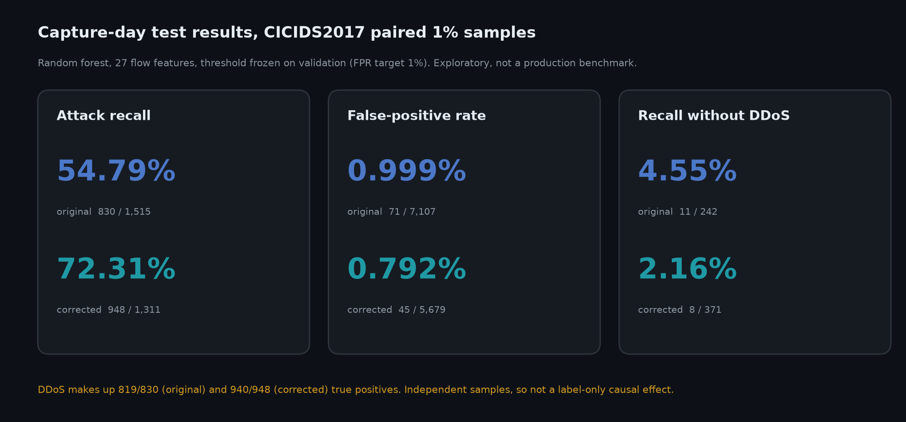
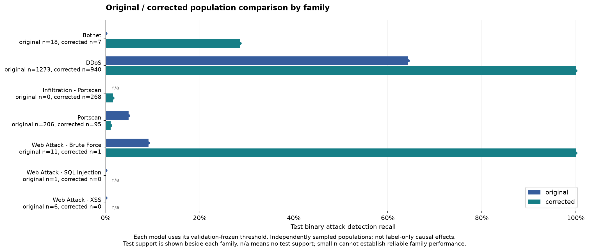
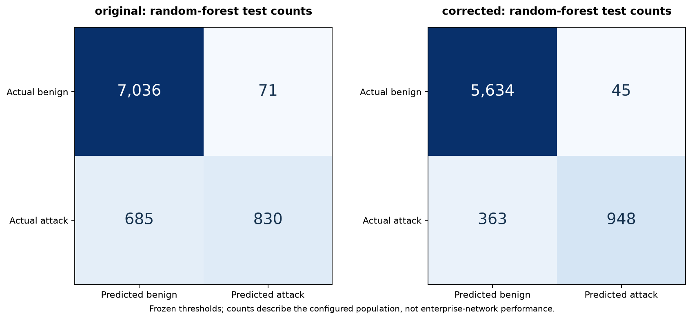
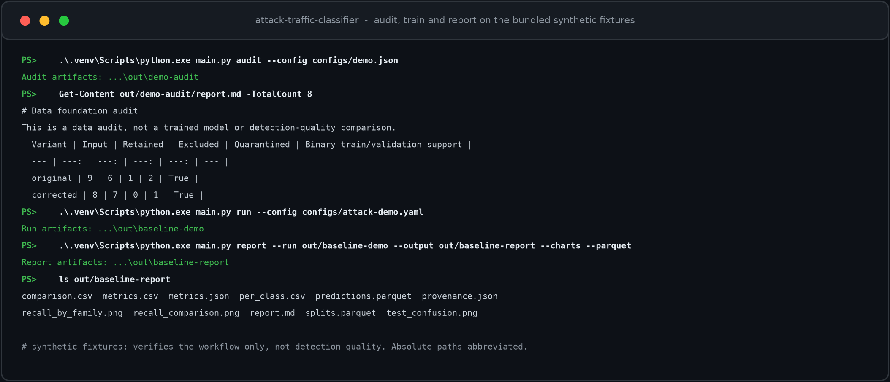

# Attack Traffic Classifier: auditable machine learning research for network intrusion detection (CICIDS2017, original vs corrected)

[](LICENSE)


**Attack Traffic Classifier is an offline, reproducible Python research pipeline that tests how a fixed intrusion-detection model behaves on the original and the corrected CICIDS2017 network-flow datasets.** It audits every input row, splits data by capture day so the future never leaks into training, picks decision thresholds on validation data only, and then reports the test results together with the reasons you should be careful about trusting them.

It is built for students, ML researchers and security engineers who want to see what rigorous, leakage-aware evaluation of an intrusion detection system (IDS) looks like. It is **not** a production IDS: it captures no live traffic and blocks nothing. See [Honest status](#honest-status).



---

## Contents

- [What it does](#what-it-does)
- [Results](#results)
- [Proof that it runs](#proof-that-it-runs)
- [How it works](#how-it-works)
- [Design principles](#design-principles)
- [Quick start](#quick-start)
- [Commands and tests](#commands-and-tests)
- [Research timeline](#research-timeline)
- [Project layout](#project-layout)
- [Honest status](#honest-status)
- [FAQ](#faq)
- [Data and licensing](#data-and-licensing)
- [Citation](#citation)
- [License](#license)

---

## What it does

### Leakage-aware dataset auditing
- **Row-by-row accounting:** every input flow ends up retained, excluded or quarantined, with a stated reason. Totals reconcile per dataset variant.
- **Schema and label checks:** column mappings, label maps, duplicate column groups and unit declarations are explicit and hashed.
- **Duplicate and boundary quarantine:** later copies of the same 27-feature vector, and flows that straddle a split boundary, are held out so they cannot leak across train, validation and test.
- **No identifiers as features:** IP addresses, ports, flow IDs, labels and timing metadata are never model inputs.

### A fair comparison of original and corrected CICIDS2017
- **Same feature policy for both:** 27 flow statistics (packet counts, packet lengths, interarrival times, active and idle durations). Disputed TCP flag fields are excluded.
- **Chronological splits:** Monday and Tuesday train, Wednesday validates, Thursday and Friday test.
- **Frozen thresholds:** each model's threshold maximises validation recall under a 1% false-positive ceiling, then stays fixed for testing.
- **Honest baselines:** a constant "never alert" baseline shows what no detection looks like.

### Reports you can audit
- **Metrics with Wilson intervals**, per-family recall, confusion matrices and precision at a fixed alert budget.
- **Saved-score report rebuilds:** the `report` command re-derives every table and chart from saved scores without retraining, then checks them against the split audit.
- **Provenance:** run manifests record configuration, source hashes, feature schema, environment and model-bundle hashes.
- **Immutable runs:** output folders are never overwritten, so evidence cannot be silently replaced.

### Research tooling
- Cross-dataset checks on CSE-CIC-IDS2018 and CIC-DDoS2019, a feature-collision audit, class-weight and feature-block ablations, and packet-level (PCAP) investigations of TCP flag semantics.
- A synthetic fixture set, so you can try the whole workflow in seconds with no dataset download.

---

## Results

These are exploratory results on **paired, deterministic 1% samples** of CICIDS2017 (original publisher release and the corrected CNS2022 release). Each model is an unweighted random forest with 200 trees. Thresholds were chosen on validation data. The corrected test capture had been looked at in an earlier experiment, so this is **not** a fresh independent confirmation.

| Test metric | Original-data model | Corrected-data model |
| --- | ---: | ---: |
| Attack recall | 54.79% | 72.31% |
| False-positive rate | 0.999% | 0.792% |
| Precision at 100 alerts | 93% | 94% |
| Attack recall excluding DDoS | 4.55% | 2.16% |



*Real-data output of the project's own `report` command. n is the number of test flows per attack family.*



*Test confusion counts at the frozen thresholds. Original: 830 of 1,515 attack flows detected, 71 of 7,107 benign flows flagged. Corrected: 948 of 1,311 detected, 45 of 5,679 flagged.*

**How to read this.** DDoS dominates what the models catch (819 of 830 true positives for the original model, 940 of 948 for the corrected one). Without DDoS, recall falls to a few percent, and validation recall on unseen attack families is only 1.29% (original) and 2.55% (corrected). The two datasets are independently sampled populations, so the gap between them does not isolate a causal effect of label correction. Later cross-capture experiments showed unstable transfer, and some false-positive rates exceeded the 1% target. Details: [model card](docs/MODEL-CARD.md), [Experiment 002](docs/EXPERIMENT-002.md), [sensitivity analysis](docs/EXPERIMENT-007-SENSITIVITY-RESULTS.md).

---

## Proof that it runs

Everything below was run on **Python 3.13.14, Windows 11**, in a fresh virtual environment built from the pinned requirements. `pip check` reported no broken requirements and the full test suite passed.

### Audit, train and report on the bundled synthetic fixtures



*These screenshots are rendered from the captured command output (absolute paths abbreviated). The fixtures are synthetic, so they prove the workflow, not detection quality. The charts in [Results](#results) come from the real-data run.*

---

## How it works

```mermaid
flowchart LR
    A[Local flow CSVs<br/>original + corrected] --> B[Audit<br/>schema, labels, row accounting]
    B --> C[Quarantine<br/>duplicates + boundary spans]
    C --> D[Chronological split<br/>train / validation / test]
    D --> E[Train<br/>constant baseline + random forest]
    E --> F[Select threshold<br/>validation only, FPR at most 1%]
    F --> G[Evaluate on test<br/>thresholds frozen]
    G --> H[Reports<br/>metrics, charts, provenance]
    H --> I[Rebuild + verify<br/>from saved scores]
```



- **Core (standard library):** the audit and partitioning need no third-party packages.
- **Training:** NumPy, scikit-learn, joblib, PyYAML and psutil (pinned in [requirements-training.txt](requirements-training.txt)).
- **Reports:** Matplotlib and PyArrow add PNG charts and Parquet exports (pinned in [requirements-report.txt](requirements-report.txt)).
- **Interface:** one command-line entry point, `main.py`, with `audit`, `run`, `score` and `report` as the core commands.

---

## Design principles

- **Time never flows backwards.** Training uses earlier capture days than validation, and validation earlier than test.
- **Test data never tunes anything.** Thresholds are frozen before the test partition is scored.
- **Accounting before modelling.** A row that disappears is a finding, so every loss is counted and shown beside the scores.
- **Say what the numbers do not show.** Each report repeats its limits: sample size, dataset bias, label uncertainty and reused captures.
- **No quiet overwrites.** Runs are immutable, and reports are rebuilt and verified rather than patched.
- **Trusted-local models only.** Model bundles are hash-checked, and you should only load bundles you produced yourself.

---

## Features at a glance

- Audits schemas, labels, duplicate feature groups and partition boundaries.
- Uses 27 flow statistics. IP addresses, ports, labels and disputed TCP flag fields are excluded.
- Compares constant baselines and random forests with capture-day splits and validation-selected thresholds.
- Records class support, predictions, metrics, provenance and limitations.
- Scores new feature files with a saved, hash-verified model bundle.
- Ships small synthetic fixtures for trying the workflow without a dataset download.

---

## Quick start

The project declares Python 3.11 or newer. The recorded research and clean-environment checks used **Python 3.13.14 on Windows**. macOS, Linux and other Python versions have not been independently verified, and package wheels may vary by platform.

### Windows PowerShell

```powershell
git clone https://github.com/maahin-1/attack-traffic-classifier.git
cd attack-traffic-classifier

py -3.13 -m venv .venv
.\.venv\Scripts\python.exe -m pip install --upgrade pip
.\.venv\Scripts\python.exe -m pip install -r requirements-report.txt
.\.venv\Scripts\python.exe main.py audit --config configs/demo.json
.\.venv\Scripts\python.exe main.py run --config configs/attack-demo.yaml
```

If the Python launcher is unavailable, use a compatible `python` command to create the environment. In Windows Command Prompt, use `.venv\Scripts\python.exe` for later commands.

### macOS and Linux

```bash
git clone https://github.com/maahin-1/attack-traffic-classifier.git
cd attack-traffic-classifier

python3 -m venv .venv
.venv/bin/python -m pip install --upgrade pip
.venv/bin/python -m pip install -r requirements-report.txt
.venv/bin/python main.py audit --config configs/demo.json
.venv/bin/python main.py run --config configs/attack-demo.yaml
```

The audit writes to `artifacts/demo-audit/` and the example run writes to `artifacts/baseline-demo/`. Output folders are immutable: to run again, copy the config, change its `output_dir` to a new path and pass that config. Paths resolve relative to the config file. The example data and metrics are synthetic.

To rebuild a report with charts and Parquet exports from a finished run:

```bash
.venv/bin/python main.py report --run artifacts/baseline-demo --output artifacts/baseline-report --charts --parquet
```

Full research reproduction needs separately obtained datasets plus substantial storage and compute. See the [historical research notes](README-RESEARCH-HISTORY.md) for data preparation and experiment commands.

---

## Commands and tests

```bash
python main.py --help
python main.py audit --help
python main.py run --help
python main.py score --help
python main.py report --help
python -m pytest -q
```

Install pytest in the virtual environment first (`python -m pip install pytest`). The suite runs offline against small fixtures. Only load trusted local model bundles.

---

## Research timeline

| Step | What was tested | Outcome |
| --- | --- | --- |
| [Experiment 002](docs/EXPERIMENT-002.md) | Paired capture-day comparison, original vs corrected CICIDS2017 | Headline results above; DDoS dominates detection |
| [Experiment 003](docs/EXPERIMENT-003.md) | Duplicate feature-group audit and class-weight ablation | 86 original and 8 corrected conflicting groups found; balanced weighting raised corrected validation recall from 2.55% to 3.59% |
| [Experiment 004](docs/EXPERIMENT-004.md) | 12 extra packet-gap features (39 total) | Failed the joint validation rule; the 27-feature reference stays |
| [Experiment 005](docs/EXPERIMENT-005.md) | More early training support | Original improved, corrected regressed; baseline kept |
| [CSE-CIC-IDS2018 robustness](docs/IDS2018-ROBUSTNESS-RESULTS.md) | Frozen 2017 models on 2018 captures | Both exceeded the 1% false-positive target on 15 February; transfer was weak |
| [Experiment 007](docs/EXPERIMENT-007-SENSITIVITY-RESULTS.md) | Sensitivity of the consumed CIC-DDoS2019 assessment | Results swing sharply when repeated feature groups are reweighted |
| [Experiment 008](docs/EXPERIMENT-008-RARE-FLAG-MATCH-RESULTS.md) | Packet-level checks of TCP flag fields | Cross-release flag semantics unresolved, so flags stay excluded |
| [Experiment 009](docs/EXPERIMENT-009-DEVELOPMENT-PLAN.md) | Plan for a TON_IoT development and holdout track | Planning and feasibility stage; no final holdout reserved yet |

The [roadmap](docs/ROADMAP.md), [release review](docs/RELEASE-REVIEW-2026-11-05.md) and [clean-environment smoke test](docs/CLEAN-ENVIRONMENT-SMOKE-2026-11-05.md) record the evidence behind each claim. Product and technical requirements are in the [PRD](PRD-01-attack-traffic-classifier.md) and [TRD](TRD-01-attack-traffic-classifier.md).

---

## Project layout

```text
attack_traffic/       Core audit, preparation, modelling and reporting
configs/              Example and research configurations
examples/             Project-authored synthetic CSV fixtures
scripts/              Research and dataset-inspection utilities
tests/                Automated checks
docs/                 Model card, experiments, release evidence and images
main.py               Offline command-line entry point
pyproject.toml        Project metadata and optional dependencies
requirements-*.txt    Pinned research dependency snapshots
data/                 Local datasets and manifests; excluded from version control
```

---

## Honest status

This is a concluded research prototype, built for learning and reproducible research.

- **Not production intrusion detection:** it does not capture traffic, contact endpoints or block connections. Its results do not establish real-world detection performance.
- **Narrow generalisation:** headline recall is dominated by DDoS. Port-scan and rare web-attack detection are weak, and most unseen validation attacks score zero.
- **Exploratory, not a fresh holdout:** the corrected test capture and the CIC-DDoS2019 assessment have been inspected, so they cannot serve as independent final tests.
- **Timing limits:** the original dataset lost its AM/PM and timezone information. Capture-day order is established, but exact event instants are not.
- **Small test window:** only two test capture days exist, so no reliable temporal-block interval is claimed. Wilson intervals assume independent flows.
- **Verified on one setup:** Python 3.13.14 on Windows. Transitive dependencies are not fully pinned.

---

## FAQ

### What is Attack Traffic Classifier?
It is an open-source, offline Python pipeline for studying machine-learning intrusion detection on network-flow data. It audits CICIDS2017 and a corrected version of it, trains random-forest classifiers with chronological splits, selects thresholds on validation data and reports the test results with their limitations.

### What problem does it study?
Intrusion-detection datasets often contain labelling errors, duplicate flows and timing problems. This project measures how a fixed pipeline behaves on the original CICIDS2017 and on the corrected CNS2022 release, and shows how much those data issues change the apparent results.

### Can I use it to detect attacks on my own network?
No. It is a research prototype for offline study. It does not capture packets, monitor live traffic or block connections, and its scores are uncalibrated. Use a maintained, production-grade IDS for real defence.

### Which dataset does it use, and do I need to download it?
It uses CICIDS2017 (original release) and the CNS2022 corrected CICIDS2017 release. You do **not** need either to try the project: bundled synthetic fixtures run the whole workflow. Reproducing the research results requires downloading the datasets yourself.

### Which machine-learning model does it use?
A scikit-learn random forest (200 trees, depth 12, seed 42) for binary attack detection, plus a closed-set random forest for per-family diagnostics and a constant baseline for comparison.

### How is it different from a typical intrusion-detection notebook?
It splits by capture day to prevent time leakage, quarantines duplicate and boundary-spanning flows, freezes thresholds before testing, counts every lost row and verifies its reports against saved scores. Its documentation lists what the results do not prove.

### Does label correction improve detection?
This project cannot say. The original and corrected datasets are independently sampled populations, so the comparison does not isolate a causal effect of correcting labels.

### Which Python version and operating system does it support?
It declares Python 3.11 or newer. All verification was done on Python 3.13.14 on Windows. macOS and Linux instructions are included but not independently verified.

### Is it free to use?
Yes. Project-authored code is under the MIT License. The datasets have their own terms, which apply separately.

---

## Data and licensing

The raw datasets are **not** included in this repository. Project-authored code, fixtures and documentation are MIT licensed. CICIDS2017 and the CNS2022 corrected release are third-party datasets with their own terms and citations, and no redistribution rights beyond the documented references are asserted. See the [dataset decision](docs/DATASET-DECISION.md) for sources, checksums and unresolved terms.

---

## Citation

If this work helps your research, you can cite it using the metadata in [CITATION.cff](CITATION.cff) (GitHub's "Cite this repository" button reads it).

---

## License

Licensed under the [MIT License](LICENSE). Copyright (c) 2026 Maahin Bir Singh Osahan.

*Keywords: intrusion detection system, network intrusion detection, IDS machine learning, CICIDS2017, CSE-CIC-IDS2018, CIC-DDoS2019, TON_IoT, CNS2022 corrected dataset, random forest, scikit-learn, cybersecurity, network security, DDoS detection, NetFlow, flow-based detection, data leakage, chronological split, label noise, dataset quality, reproducible research, model card, Python, open source.*
